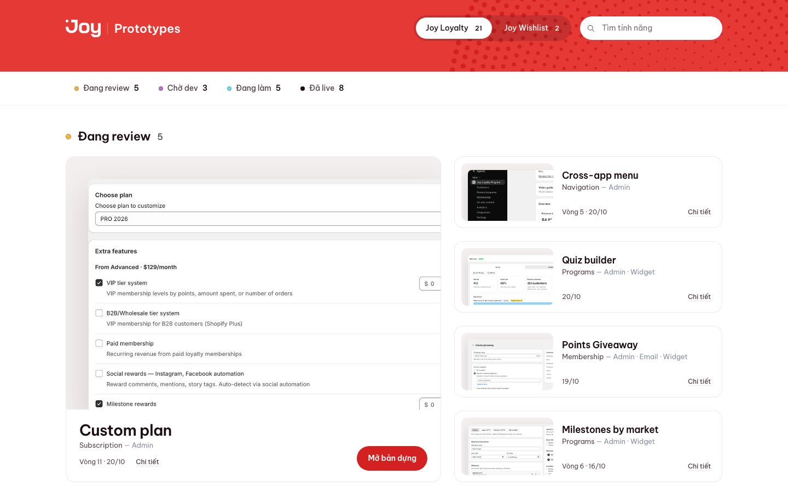
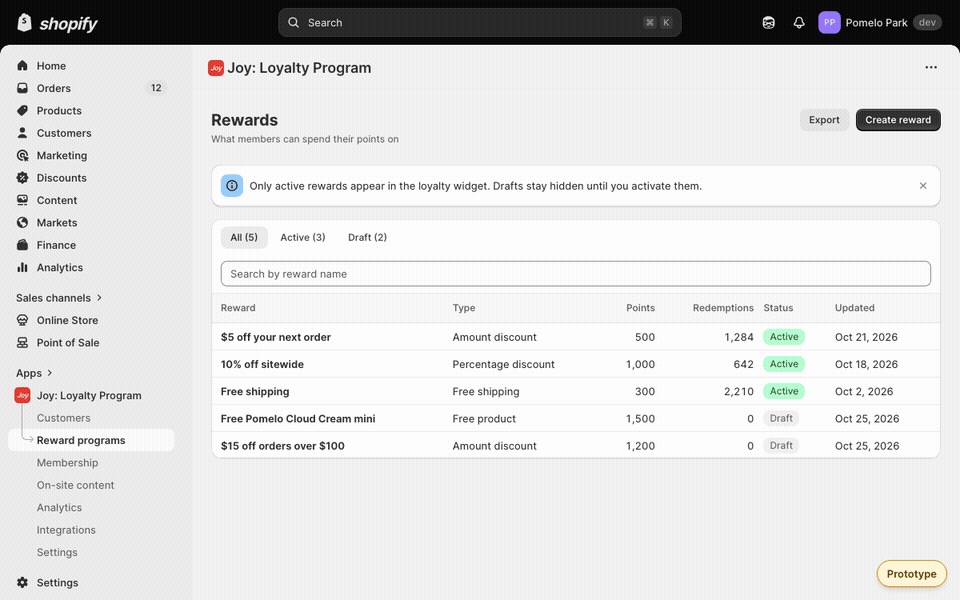
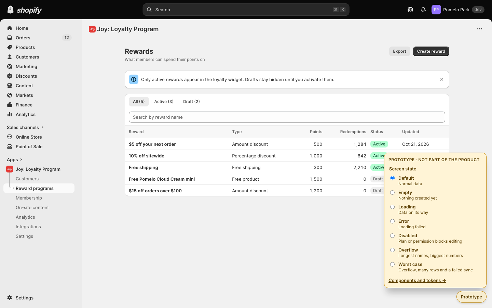
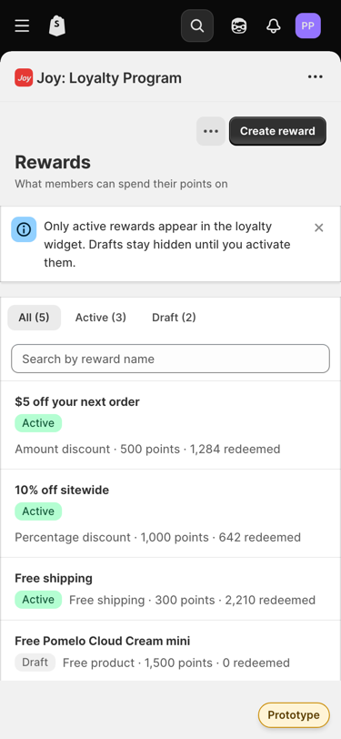
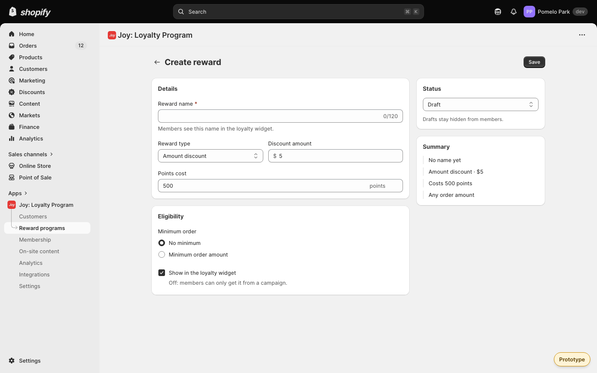

<p align="center">
  <a href="https://joy-prototypes.web.app"></a>
</p>

<h1 align="center">Joy Prototypes</h1>

<p align="center">
  Mọi prototype của Joy Loyalty và Joy Wishlist ở một link.<br>
  Bấm như app thật, dữ liệu giả, mỗi Pull Request có link xem thử riêng.
</p>

<p align="center">
  <a href="https://joy-prototypes.web.app"><b>Mở hub</b></a> ·
  <a href="https://joy-prototypes.web.app/starter/"><b>Xem bộ khung chuẩn</b></a> ·
  <a href="GUIDELINE.md">Guideline</a> ·
  <a href="#bắt-đầu-6-bước">Bắt đầu trong 6 bước</a>
</p>

<p align="center">
  <a href="https://github.com/khanhsonwork-glitch/joy-prototypes/actions/workflows/live.yml"></a>
  <a href="https://github.com/khanhsonwork-glitch/joy-prototypes/actions/workflows/pull-request.yml"></a>
</p>

Repo này chỉ chứa prototype tĩnh với dữ liệu giả: không có code production của Joy, không có dữ liệu merchant/khách, không có secret.

| | |
|---|---|
| **Hub All-in-one** | Mọi prototype xếp theo trạng thái (đang review, chờ dev, đang làm, đã live), tìm theo tên tính năng, lọc theo sản phẩm. |
| **Bộ khung chuẩn** | Một lệnh tạo prototype mới trong khung Shopify admin + Polaris, đủ 9 trạng thái, form, modal, drawer, chạy được từ 375px tới 1440px. |
| **Cổng kiểm tự động** | Mỗi Pull Request quét secret, link nội bộ, email thật, tên merchant thật (cả chữ trong ảnh), license, rồi test trình duyệt trước khi có link xem thử. |

- **Link chung (live):** https://joy-prototypes.web.app — chỉ đổi khi một Pull Request được merge vào `main`.
- **Link xem thử:** mỗi Pull Request có link riêng `https://joy-prototypes--pr<số>-….web.app`, bot tự comment vào PR và cập nhật sau mỗi lần push.

Prototype khác trong hub là link tới trang riêng của chúng (khai báo trong `hub/data/registry.json`); source của chúng không nằm ở đây.

### Một màn, bảy trạng thái

Nút **Prototype** màu hổ phách (không phải UI sản phẩm) đổi màn giữa Default, Empty, Loading, Error, Disabled, Overflow và Worst case, để người duyệt thấy cả những trạng thái hay bị quên. Cộng hover và focus (rê chuột, phím Tab) là đủ 9 trạng thái mà [`GUIDELINE.md`](GUIDELINE.md) bắt mọi màn phải có.

<p align="center">
  
</p>

<table>
  <tr>
    <td width="66%"></td>
    <td width="34%" align="center"></td>
  </tr>
  <tr>
    <td>Bảng trạng thái và trang component + token, tách khỏi sản phẩm bằng màu hổ phách.</td>
    <td align="center">Điện thoại: nút nằm trong dải riêng, không che dòng nào.</td>
  </tr>
</table>

### Prototype mới trong một lệnh

```bash
npm run new -- birthday-reward "Birthday reward"
npm run dev -- birthday-reward
```

Lệnh đầu chép bộ khung chuẩn vào `demos/birthday-reward/`, thêm thẻ "Đang review" vào hub và chụp ảnh thẻ. Đủ 6 bước từ clone tới merge ở ngay dưới.

<p align="center">
  
</p>

## Bắt đầu: 6 bước

Cần Node 22.12 trở lên (`node -v`; thiếu thì `nvm install 22 && nvm use 22`) và quyền push vào repo (nhờ người giữ hub mời làm collaborator). Bước 1 chỉ làm một lần trên mỗi máy.

1. **Cài:** `git clone https://github.com/khanhsonwork-glitch/joy-prototypes.git && cd joy-prototypes && npm ci`
2. **Mở nhánh:** `git switch main && git pull && git switch -c <tên-việc>` (ví dụ `birthday-reward`)
3. **Tạo prototype:** `npm run new -- birthday-reward "Birthday reward"` — chép bộ khung chuẩn vào `demos/birthday-reward/`, cài, thêm thẻ "Đang review" vào hub và chụp ảnh thẻ. Tuỳ chọn: `--product wishlist`, `--area "Membership"`.
4. **Sửa:** `npm run dev -- birthday-reward`, sửa màn trong `demos/birthday-reward/src/pages/` theo [`GUIDELINE.md`](GUIDELINE.md) (khung, component, 9 trạng thái, điều cấm). Xem mẫu chuẩn trước: https://joy-prototypes.web.app/starter/
5. **Kiểm:** `npm run shot -- birthday-reward --replace` (ảnh thẻ mới), rồi `npm run check` — đúng bộ kiểm CI sẽ chạy.
6. **Gửi duyệt:** `git add -A && git commit -m "<sửa gì>" && git push -u origin <tên-việc>`, mở Pull Request từ link GitHub in ra. CI dựng link xem thử riêng và comment vào PR; gửi link đó cho người duyệt; merge khi check xanh thì link chung tự cập nhật.

Sửa một demo đã có: bỏ bước 3, ở bước 4 dùng `npm run dev -- <tên>` (danh sách: `npm run dev`). Sửa hub: `npm run dev -- hub`.

Không ai đẩy thẳng lên `main` hay deploy tay: `main` bị khoá, chỉ nhận PR có check xanh. Hai merge sát nhau: deploy chạy lần lượt, bản mới nhất thắng.

### Khi bị xung đột

GitHub báo PR "This branch has conflicts" khi hai người sửa cùng chỗ một file. Chỗ hay gặp nhất là `hub/data/registry.json` (danh sách thẻ hub).

1. Ở nhánh của mình: `git pull origin main`.
2. Mở file git báo, giữ phần của cả hai người (với `registry.json`: giữ cả hai thẻ, không xoá thẻ của người kia).
3. `npm run check`, rồi `git add`, `git commit`, `git push`. PR tự chạy lại check và link xem thử.

`npm run new` chèn thẻ mới theo thứ tự tên chứ không dồn vào cuối file, nên hai người cùng thêm demo mới thường không xung đột.

## Sửa thẻ trên hub

Đổi tên, khu vực, trạng thái, ảnh của thẻ: sửa đúng record đó trong `hub/data/registry.json`. Ảnh thẻ ở `hub/public/shots/`, tối đa 1600×900, là ảnh màn prototype. Thẻ không dùng nữa thì xoá cả record (repo public: link giữ lại trong thẻ ẩn vẫn bị lộ, và `npm run check` chặn).

## `npm run check` kiểm gì

1. Quét toàn bộ file trong repo: secret/token, link nội bộ (Notion, GitLab, Google Docs…), email thật (chỉ cho `@example.com`, `*.example`), tên merchant thật trong `privacy/blocklist.json` (lưu dạng mã băm; thêm tên: `npm run privacy:add -- "<tên>"`), thẻ ẩn còn giữ link.
2. Đọc chữ trong mọi ảnh (OCR chạy offline) và chặn cùng các thứ trên, cộng chữ của ghi chú nội bộ (UAT, staging, mã task).
3. License: mọi package đã cài (kể cả gói con) phải có license đã duyệt, mọi font phải là SIL OFL có file license đi kèm. Danh sách: [`THIRD_PARTY_LICENSES.md`](THIRD_PARTY_LICENSES.md).
4. Tự kiểm các cổng trên (gài lỗi giả, phải bắt được) và lệnh `npm run new` (tên sai, tên dành riêng, trùng, ghi đè, đường thành công).
5. Build `dist/` (hub + starter + demo + `dist/firebase.json` sinh từ registry), quét lại bundle công khai.
6. Test trình duyệt: hub (thẻ, tìm kiếm, redirect, 404, font, ảnh), starter (9 trạng thái, form, modal, drawer, bàn phím, 375/768/1440px, không gọi ra ngoài) và mọi demo (mở được, không lỗi, không cuộn ngang). Ảnh chụp ở `evidence/` (không đưa lên Git; trên CI nằm trong artifact `evidence`).

Xem bản build hoàn chỉnh như trên Firebase: `npm run build`, rồi `npm run serve`.

## Cấu trúc

```text
hub/                    Hub All-in-one (React + Vite). Dữ liệu thẻ: hub/data/registry.json
demos/<slug>/           Mỗi demo một app Vite riêng; hub dựng nó ở /<product>/<slug>/
templates/demo/         Bộ khung chuẩn (starter) mà npm run new chép ra; hub phục vụ ở /starter/
docs/readme/            Ảnh của README này (cũng đi qua cổng đọc chữ trong ảnh)
GUIDELINE.md            Cách dựng prototype: khung, component, 9 trạng thái, điều cấm
THIRD_PARTY_LICENSES.md License của dependency và font
privacy/blocklist.json  Mã băm tên merchant/brand thật cần chặn
scripts/                build, dev, serve, new-demo (npm run new), shot, check-*
test/                   Test trình duyệt (hub, starter) và test cho cổng kiểm + lệnh scaffold
.github/workflows/      pull-request.yml: check + link xem thử · live.yml: merge vào main → link chung
```

## Người giữ hub

- Firebase project `joy-prototypes` (gói Spark miễn phí). CI deploy bằng service account lưu trong GitHub Secret `FIREBASE_SERVICE_ACCOUNT_JOY_PROTOTYPES`; không ai cần đăng nhập Firebase để làm việc hằng ngày.
- `main` được bảo vệ: bắt buộc PR, bắt buộc check `check_and_preview` xanh, áp cả cho admin, cấm force-push.
- PR từ fork vẫn được check nhưng không có link xem thử (fork không đọc được secret): mời người đó làm collaborator.

## Khi bị lỗi

- `Cần Node 22.12 trở lên`: `nvm install 22 && nvm use 22`, rồi `npm ci` lại.
- `Thiếu Vite` hoặc lỗi module: chạy lại `npm ci`.
- Port đang bận: `npm run serve -- hub 4180` (số cuối là port).
- PR không có link xem thử: mở tab Checks của PR xem bước nào đỏ; check đỏ thì không deploy.
